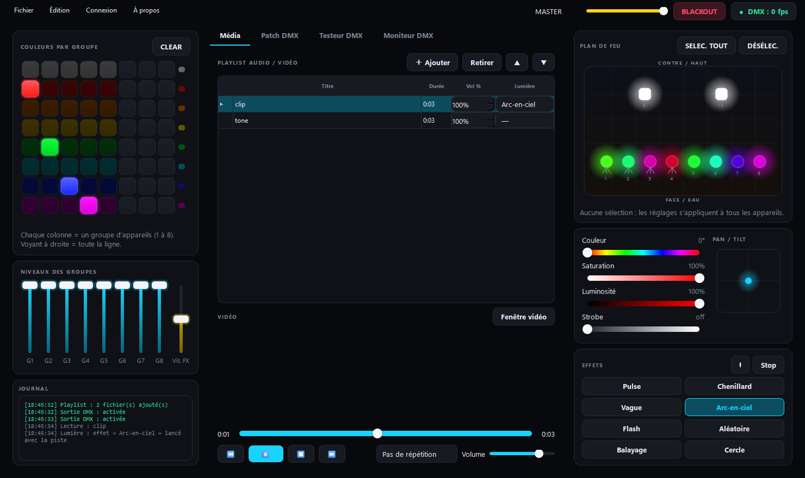
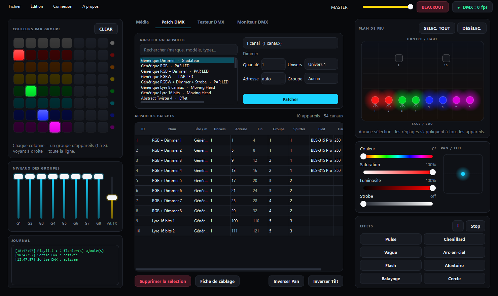
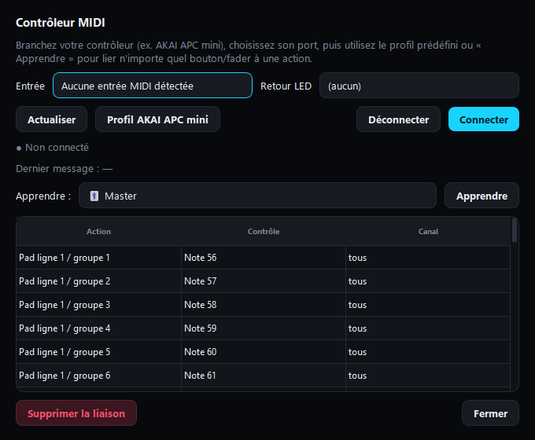

# YouStrow

Contrôleur lumière DMX pour **Windows et Ubuntu/Linux** : sortie **ENTTEC Open DMX USB**, lecteur audio/vidéo, contrôle **MIDI** (AKAI APC mini), plan de feu live.
Python 3.12 + PySide6 (Qt 6). Le moteur DMX est indépendant de l'interface.



| Patch + splitter + pieds | MIDI |
|---|---|
|  |  |

## Installer
Téléchargez `YouStrow-Setup-x.y.z.exe` depuis les [Releases](../../releases) et lancez-le (pas besoin d'être administrateur).
Les réglages sont dans `%APPDATA%\YouStrow\` et conservés à la désinstallation.

## Installer sur Ubuntu / Debian
```bash
./build.sh                                   # tests + dist/YouStrow/ + dist/youstrow_X.Y.Z_amd64.deb
sudo apt install ./dist/youstrow_X.Y.Z_amd64.deb
```
ou, sans paquet, directement depuis les sources : `./install.sh` (dépendances apt, venv, règle udev, lanceur de menu).
Réglages dans `~/.config/YouStrow/`. Un `.deb` installe aussi la règle udev (accès à l'Open DMX sans root) et l'association des `.ysshow`.

**Open DMX sous Linux** : le noyau charge `ftdi_sio`, qui empêche D2XX d'ouvrir la puce. Le plus simple : sortie
*Open DMX / clone via port série (COM / ttyUSB)* → `/dev/ttyUSB0` (ajouter l'utilisateur au groupe `dialout`, puis se reconnecter).
Pour le mode D2XX : installer `libftd2xx.so` (ftdichip.com) et `sudo rmmod ftdi_sio usbserial`. Art-Net et DMX USB PRO fonctionnent tels quels.
Non testé avec du matériel réel, comme la version Windows.

## Fonctions (voir aussi docs/FEATURES.md et docs/FIGMA.md)
- **Sorties DMX** : ENTTEC Open DMX USB (pilote D2XX, ou port COM pour les clones), ENTTEC DMX USB PRO, Art-Net (avec recherche de nodes). Assistant de connexion + diagnostic, test 100 %.
- **Patch** : 4 univers, ~1800 appareils (bibliothèque QLC+), anti-chevauchement, groupes, inversion Pan/Tilt.
- **Rig** : affectation des appareils aux 8 sorties d'un **splitter Showtec DB-1-8** (fiche de câblage, limite 32 appareils/ligne) et à un **pied Stairville BLS-315 Pro** (hauteur 150–310 cm). Ces deux matériels sont passifs : ils sont documentés et contrôlés, pas pilotés.
- **Pilotage** : pads de couleurs par groupe, niveaux de groupes, master, blackout, couleur/saturation/luminosité/strobe, Pan/Tilt 16 bits, 8 effets + éditeur par couches.
- **Média** : playlist audio/vidéo (mp3, wav, flac, ogg, m4a, mp4, mkv…), volume par piste, répétition, vidéo détachable/plein écran, **effet lumineux lancé avec chaque piste**.
- **MIDI** : profil AKAI APC mini (pads 8×8, faders 1-8, master, retour LED) + apprentissage de n'importe quel bouton/fader.
- **Plan de feu 2D** live, **testeur DMX** (512 faders), **moniteur DMX**, shows `.ysshow`.

État détaillé : [docs/FEATURES.md](docs/FEATURES.md). Pas encore : timeline lumière, plan 3D, éditeur de fixtures, IA (volontairement exclue pour l'instant).

## Développer
Ubuntu :
```bash
python3 -m venv .venv && .venv/bin/pip install -r requirements.txt   # apt : libasound2-dev (python-rtmidi)
.venv/bin/python -m youstrow
QT_QPA_PLATFORM=offscreen .venv/bin/python -m pytest tests -q
```
Windows :
```powershell
py -3.12 -m venv .venv; .\.venv\Scripts\python.exe -m pip install -r requirements.txt pyinstaller
.\.venv\Scripts\python.exe -m youstrow          # lancer depuis les sources
.\.venv\Scripts\python.exe -m pytest tests -q   # 40 tests, sans matériel
.\build.ps1                                     # tests + dist\YouStrow\YouStrow.exe + dist\YouStrow-Setup-x.y.z.exe (Inno Setup 6)
```
```
youstrow/
  engine/        sans Qt : ftdi.py (D2XX/ctypes + FakeBackend), universe, console (rendu), effects, midi, outputs/ (open_dmx, enttec_pro, artnet)
  fixtures/      model.py (bibliothèque, patch), rig.py (splitter, pieds)
  storage/       réglages et shows (écriture atomique)
  controller.py  pont moteur <-> interface
  ui/            thème, widgets dessinés à la main, fenêtre principale, médias, MIDI, dialogues
```
Ajouter un protocole de sortie = une classe qui hérite de `DmxOutput`.

## ENTTEC Open DMX USB
Interface passive : le PC fabrique BREAK + MAB + trame en continu (250 000 bauds, 8N2, start code 0, 512 canaux, ~30 images/s, max 44).
Reconnexion automatique, noir envoyé à la déconnexion.

**À tester avec une vraie interface** (le développement s'est fait sans matériel : la logique est validée par tests, pas encore sur du DMX réel) :
1. Brancher l'Open DMX, **fermer tout autre logiciel DMX**.
2. `Connexion ▸ Sortie DMX` → *ENTTEC Open DMX USB (D2XX)* → Actualiser → Connecter (pastille verte).
3. Un projecteur sur adresse 1, terminateur 120 Ω en bout de ligne ; `Testeur DMX` → fader du canal 1.
4. Avec le splitter : interface → entrée du Showtec DB-1-8, un terminateur par sortie utilisée.

## Licence
MIT — voir [LICENSE](LICENSE). Composants tiers : [NOTICE.md](NOTICE.md).
